<p align="center">
  <a href="README.md">简体中文</a> · <b>English</b>
</p>

<p align="center">
  <picture>
    <source media="(prefers-color-scheme: dark)" srcset="docs/assets/hero-en-dark.webp">
    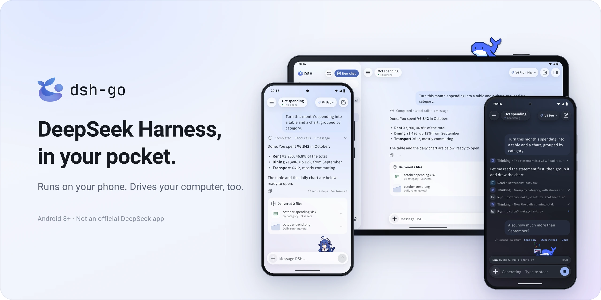
  </picture>
</p>

<p align="center">
  An iOS client for DeepSeek Harness. This source tree has been reduced to iOS and builds with Mac and Xcode using your own signing team. Install the on-device engine from inside the app when needed (<a href="app/ios/README.md">iOS build and engine setup</a>).
</p>

<p align="center">
  <a href="app/ios/README.md"></a>
  <a href="LICENSE"></a>
  <a href="https://forum.dshtui.com"></a>
  <a href="https://qm.qq.com/q/OEy2RqZnqY"></a>
</p>

<p align="center">
  <a href="https://trendshift.io/repositories/319451"></a><br>
  <sub>#1 on Trendshift's all-language daily ranking · 2026-10-30</sub>
</p>

<br>

<h3 align="center">Deepy and Whale girl keep you company</h3>

<p align="center">They code, flip, wave and nap along with DSH. On iOS, display outside the app uses Picture in Picture, and home-screen widgets show companion status.</p>

<p align="center">
  <picture><source media="(prefers-color-scheme: dark)" srcset="docs/assets/pet-deepy-typing-en-dark.gif">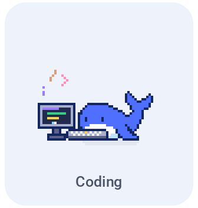</picture> <picture><source media="(prefers-color-scheme: dark)" srcset="docs/assets/pet-deepy-happy-en-dark.gif">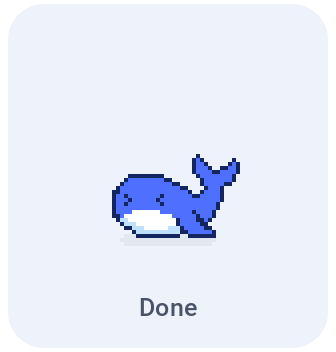</picture> <picture><source media="(prefers-color-scheme: dark)" srcset="docs/assets/pet-deepy-notification-en-dark.gif">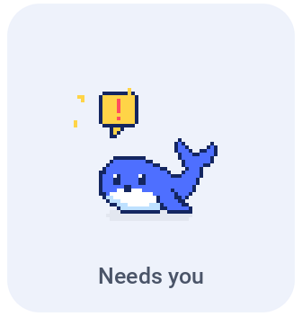</picture> <picture><source media="(prefers-color-scheme: dark)" srcset="docs/assets/pet-deepy-sleeping-en-dark.gif">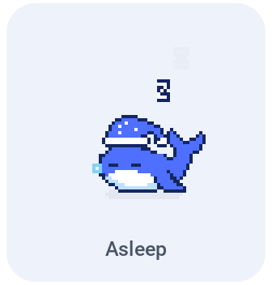</picture>
</p>

<p align="center">
  <picture><source media="(prefers-color-scheme: dark)" srcset="docs/assets/pet-girl-typing-en-dark.gif">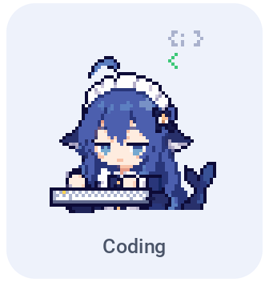</picture> <picture><source media="(prefers-color-scheme: dark)" srcset="docs/assets/pet-girl-happy-en-dark.gif"></picture> <picture><source media="(prefers-color-scheme: dark)" srcset="docs/assets/pet-girl-notification-en-dark.gif"></picture> <picture><source media="(prefers-color-scheme: dark)" srcset="docs/assets/pet-girl-sleeping-en-dark.gif">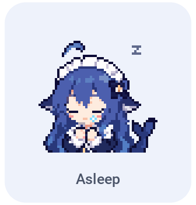</picture>
</p>

<br>

<a id="download"></a>
<h3 align="center">Build the iOS app in Xcode</h3>

<p align="center">Open <code>app/ios/Runner.xcworkspace</code>, choose Runner and a simulator or your iPhone. Installing on a device requires your own Apple signing configuration.</p>

<p align="center">
  <a href="app/ios/README.md"><b>iOS builds, runtime download sources and device signing</b></a>
</p>

<p align="center">
  <b>This source tree no longer provides Android or HarmonyOS builds. Upstream releases and the historical screenshots below do not mean that this copy has a public iOS package or has passed device acceptance testing.</b>
</p>

<p align="center">
  <a href="https://github.com/ccch1mneyyy/dsh-go/stargazers"></a>
</p>

<p align="center">
  <sub>New here? Start with the <a href="docs/guide/README.md">user guide</a>, and bring questions to the <a href="#community">forum and QQ group</a>.</sub><br>
  <sub>Back up your data before changing signing or Bundle IDs. Uninstalling the app clears its local environment and settings.</sub>
</p>

<br>

<h3 align="center">Runs on your phone. Drives your computer.</h3>

<p align="center">Run the engine with NodeMobile inside the app, optionally install sandboxed Alpine Linux, or connect to DSH on a computer or server.</p>

<p align="center">
  <picture>
    <source media="(prefers-color-scheme: dark)" srcset="docs/assets/f-remote-en-dark.webp">
    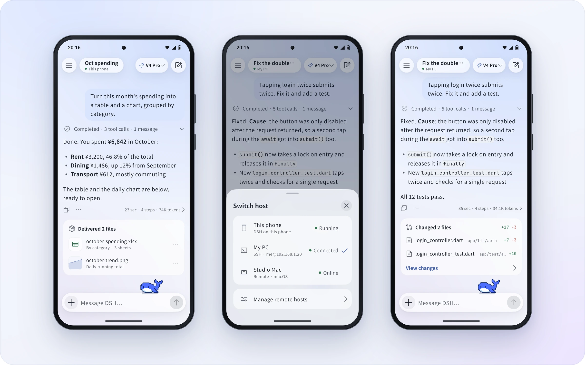
  </picture>
</p>

<br>

<h3 align="center">Chime in, interrupt, stay tidy</h3>

<p align="center">Send a message while DSH is replying, and tap "Send now" whenever you like. Finished steps fold into one line.</p>

<p align="center">
  <picture>
    <source media="(prefers-color-scheme: dark)" srcset="docs/assets/f-steer-en-dark.webp">
    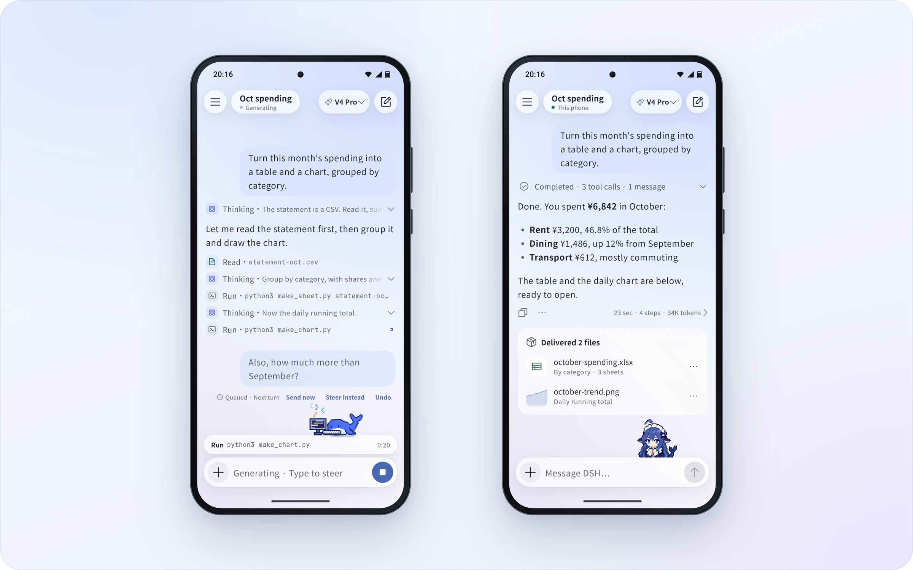
  </picture>
</p>

<br>

<h3 align="center">Native, with the web interface one tap away</h3>

<p align="center">Switch between the native app and the official web interface on the same chat. It reopens in whichever you used last.</p>

<p align="center">
  <picture>
    <source media="(prefers-color-scheme: dark)" srcset="docs/assets/f-web-en-dark.webp">
    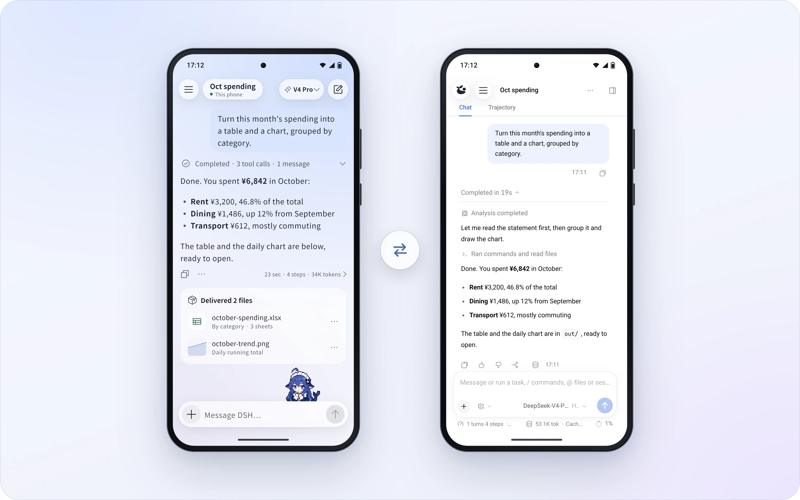
  </picture>
</p>

<br>

<h3 align="center">Share cards, replays and links</h3>

<p align="center">Turn a reply into a share card. Share a whole chat as a link that replays in any browser, end-to-end encrypted.</p>

<p align="center">
  <picture>
    <source media="(prefers-color-scheme: dark)" srcset="docs/assets/f-share-en-dark.webp">
    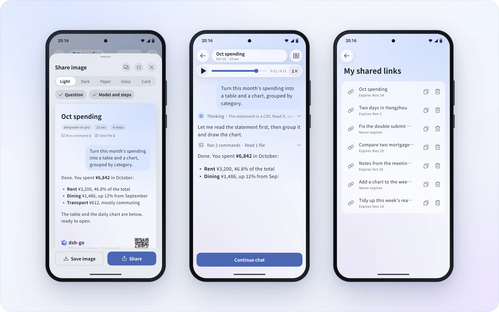
  </picture>
</p>

<br>

<h3 align="center">Landscape and tablets</h3>

<p align="center">New layouts for landscape phones and tablets: the sidebar stays, content stays centered, the keyboard never crowds.</p>

<p align="center">
  <picture>
    <source media="(prefers-color-scheme: dark)" srcset="docs/assets/f-adaptive-en-dark.webp">
    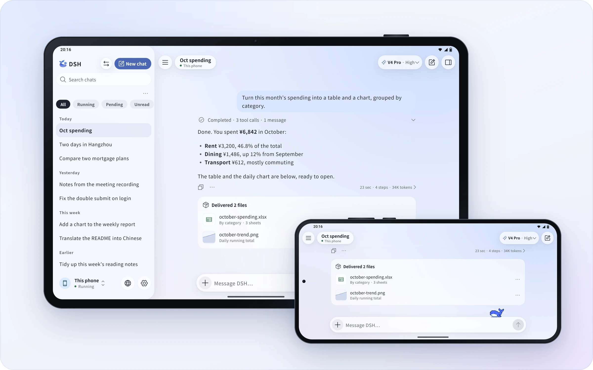
  </picture>
</p>

<br>

<h3 align="center">Colors and home screen icons</h3>

<p align="center">Six accent colors, or choose your own. Four home screen icons and three icon styles.</p>

<p align="center">
  <picture>
    <source media="(prefers-color-scheme: dark)" srcset="docs/assets/f-theme-en-dark.webp">
    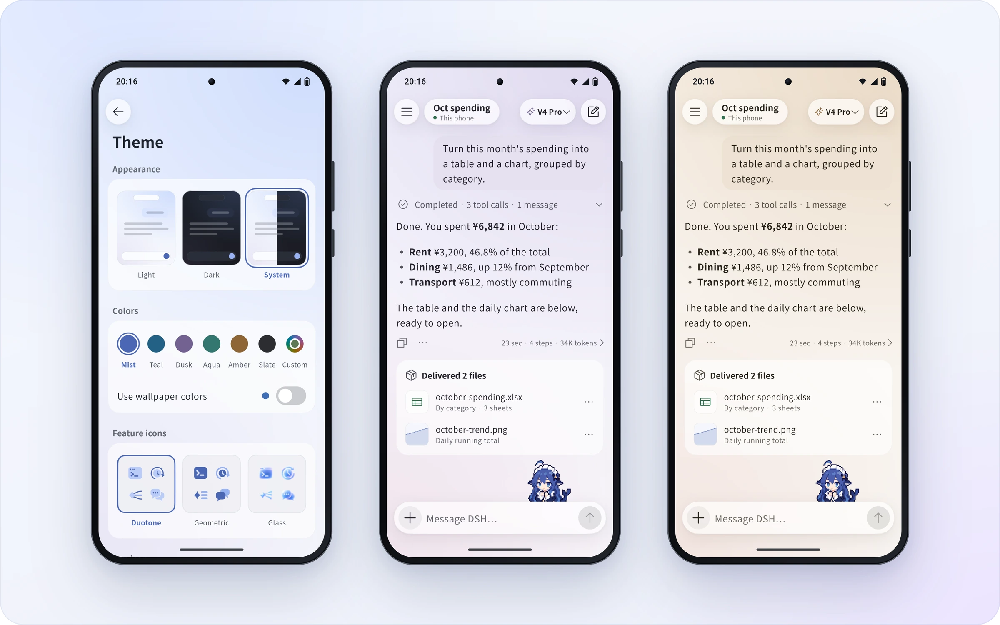
  </picture>
</p>

<br>

<h3 align="center">English and 中文</h3>

<p align="center">The whole app speaks both. It follows your system, or pick one in Settings.</p>

<p align="center">
  <picture>
    <source media="(prefers-color-scheme: dark)" srcset="docs/assets/f-lang-dark.webp">
    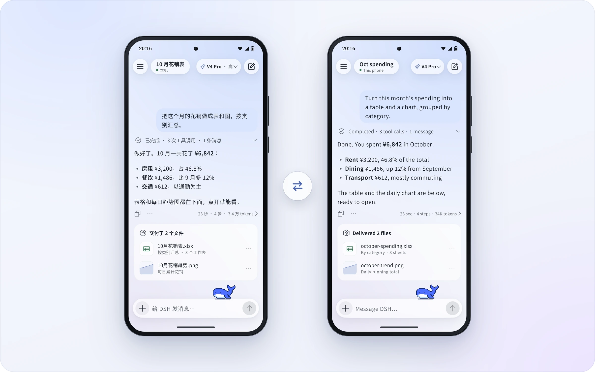
  </picture>
</p>

<br>

<h3 align="center">Phone control</h3>

<p align="center">Use an iOS developer connection to open apps and read the screen. Taps and typing depend on system services or a separately signed XCTest enhancement. Phone tasks require your authorization, and sensitive actions return to you.</p>

<p align="center">
  <picture>
    <source media="(prefers-color-scheme: dark)" srcset="docs/assets/f-phone-en-dark.webp">
    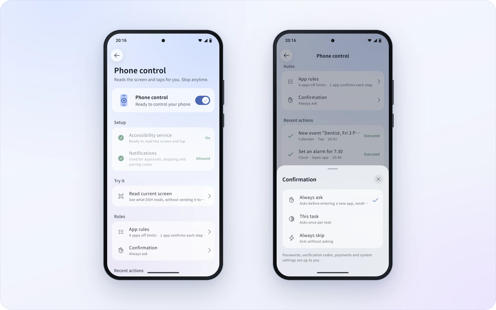
  </picture>
</p>

<br>

## Features

DSH Go combines a chat interface, an on-device runtime and remote connections. It is a third-party project built on [DeepSeek Harness](https://github.com/deepseek-ai/deepseek-harness). The DSH engine runs on your phone; model requests are still handled by the model provider you configure.

This copy retains the iOS app and its shared dependencies. The screenshots above and some guides preserve upstream multi-platform history; see the [iOS project notes](app/ios/README.md) for current iOS capabilities and limits.

- **On-device runtime:** download and install the DSH JavaScript runtime inside the app, using NodeMobile signed with the application. Alpine Linux is an optional separate installation.
- **Remote connections:** use DSH on a computer or server through SSH or [DSHarness Remote](https://github.com/liguobao/ds-harness-remote), developed by Li Guobao (liguobao).
- **Chat and tools:** switch models, send images, use voice input, and respond to tool approvals and questions. Chat and web interfaces are available.
- **Plugin interfaces:** use native tool cards, forms and panels from plugins adapted for DSH Go. This repository includes an SDK, guides and examples.
- **Phone control:** authorize an iOS developer connection to query and open apps and read screens with OCR. Taps and typing require supported device services or a signed XCTest enhancement.
- **Sharing and appearance:** share, export and replay conversations, and customize themes, icons and pets.

Capabilities depend on the host and connection. DSHarness Remote currently accepts image attachments only, does not open the web interface inside the app, limits plugin management to enabling or disabling plugins, and does not support DS Bot or conversation-log export. See [Engine and remote hosts](docs/guide/en/03-engine-hosts.md).

## Install

iOS 15 or later is required. Prepare the project using [Build from source](#build-from-source). A device installation needs a Team, Bundle IDs and compatible sharing entitlements in Xcode. Reducing this source tree to iOS does not verify signing, installation or engine operation on your device.

1. Run `Runner` in Xcode, or install a build signed with your own team on an iPhone/iPad.
2. Tap Install on the local-engine page in Settings. A build configured with a download source downloads the runtime, checks SHA-256, size and version, and deletes the ZIP after successful installation.
3. Start the installed local engine, configure model credentials, and begin a conversation. You can also connect directly to a remote host.

A remote-only setup does not need a local runtime download. The builder must configure a real runtime URL and upload the ZIP to it; the example hostname does not provide an installable runtime. See the [iOS project notes](app/ios/README.md) for background execution, system permissions and phone-control limits.

## Data and permissions

Model requests go to the provider you configure. During phone-control tasks, relevant screen text may be sent to the model, and vision-capable models may receive screenshots. Read the app's permission disclosure before enabling the feature.

“Send anonymous usage statistics” is on by default. You can turn it off during onboarding or in Settings → Privacy and sharing. See [Troubleshooting](docs/guide/en/11-faq.md) for the fields collected and what happens when it is disabled. Review content before sharing it; recipients can save a copy of a shared link or file's contents.

## Risks and disclaimer

DSH Go is an unofficial community project. It is not affiliated with, endorsed by, or a representative of DeepSeek. Before using it, please understand:

- **AI is fallible:** answers, code and actions may be wrong, and malicious instructions in web pages, messages or files may mislead it. Verify important results; do not rely solely on AI output for high-stakes medical, legal or investment decisions.
- **Tools have real effects:** commands and file changes on local or remote hosts, as well as phone control, may cause data loss, privacy breaches, or harm to accounts, funds or devices. Skipping confirmations, relaxing app rules or lifting limits reduces safeguards; confirmation and blocking mechanisms cannot eliminate all risks. Keep default protections, grant only necessary permissions, and avoid lifting limits on devices holding payment or banking details. See the [phone-control guide](docs/guide/en/04-phone-control.md).
- **Third-party services and costs:** models, remote hosts and plugins operate under their own terms. Data handling, availability and charges depend on the services and configuration you choose. Running locally does not mean the model is offline or that data never leaves the device.
- **Take precautions:** back up important data, connect only to trusted hosts, install only trusted plugins, and monitor model usage and costs. Do not leave AI unattended on irreversible or high-risk tasks.
- **No warranty and limits of liability:** to the extent permitted by applicable law, the software is provided “as is,” without guarantees of accuracy, continuous availability or fitness for a particular purpose. See sections 15–17 of [LICENSE](LICENSE) for warranty disclaimers and liability limits. This notice does not exclude or limit liability that cannot legally be excluded or limited, or reduce your statutory rights.

## FAQ

<details>
<summary><b>Is this an official DeepSeek app?</b></summary>
<br>

No. DSH Go is an unofficial client made by the community, built on the open-source [DeepSeek Harness](https://github.com/deepseek-ai/deepseek-harness). DSH itself runs on your phone; model requests go to the provider you configure, so it needs a connection and bills your account with that provider.

</details>

<details>
<summary><b>Is it safe?</b></summary>
<br>

The local web interface only answers to the app itself. Shared links are end-to-end encrypted: the key lives only in the link, and the server never sees the content, but anyone with the complete link can read and save it. Phone control retains sensitive-action protections by default; relaxing app rules or using “Lift limits” reduces those protections. Safeguards cannot guarantee zero risk. See [Risks and disclaimer](#risks-and-disclaimer) and the [phone-control guide](docs/guide/en/04-phone-control.md).

</details>

<details>
<summary><b>Will the system kill it in the background?</b></summary>
<br>

iOS restricts background execution and may suspend the local engine. The app checks and restores the connection when it returns to the foreground. Continued processing on iOS 26 remains a system decision and does not guarantee indefinite background execution. See the [iOS project notes](app/ios/README.md).

</details>

<details>
<summary><b>What phone do I need?</b></summary>
<br>

An iPhone/iPad running iOS 15 or later, with a Mac and Xcode to build and sign the app. The local engine needs extra space for downloading and extraction, and optional Linux uses more. A remote-only setup does not need that installation.

</details>

<details>
<summary><b>Is it open source?</b></summary>
<br>

Yes. The code is in this repository under [AGPL-3.0](LICENSE); `sdk/` and `examples/` are MIT. The DSH Go name and logo, and the mascots Deepy and Whale girl, are not covered by the open-source license; see [ASSETS.md](ASSETS.md). Credit requirements for forks and redistributed builds are in [License scope and redistribution](#license-scope-and-redistribution).

</details>

## Build from source

The local toolchain is **macOS, Xcode 27.2, Flutter 3.47.7 / Dart 3.13.5, and Python 3.11+** (the historical upstream CI uses Xcode 26.6). Native engine builds also need LLVM, lld, Meson and Ninja; see the [iOS project notes](app/ios/README.md). Keep all fonts, images and packages declared in `app/pubspec.yaml`.

Run from this source tree's root:

```bash
bash tooling/ios/prepare-engine.sh
python3 tooling/ios/configure-runtime-download.py --url https://your-host/path/
cd app
flutter pub get
open ios/Runner.xcworkspace
```

`prepare-engine.sh` prepares `app/ios/Engine/runtime.zip`, NodeMobile and native build inputs. The configuration script writes `app/ios/runtime-download.json` and exports `dist/ios-runtime/runtime-<SHA256>.zip`. Upload the exported ZIP to the same HTTPS location before building the app. Regenerate the configuration and upload the matching file whenever the runtime changes. With a download source configured, Xcode embeds only the download metadata, required native frameworks and small iOS tool resources; tapping Install inside the app downloads the runtime.

Choose the `Runner` scheme and a simulator for local compilation. For a device, configure `Runner`, `ShareExtension` and `CompanionWidget` with the same Team and compatible shared entitlements. An unsigned build cannot be installed on an iPhone.

Run unsigned compilation checks from `app/`:

```bash
flutter build ios --simulator --debug
flutter build ios --release --no-codesign
```

For simulator download development, use `--allow-local-debug --url http://127.0.0.1:8787/` and serve `dist/ios-runtime` with a local static server. HTTP loopback is for Debug simulator builds only; Release builds require HTTPS. Full commands and native-framework/signing constraints are in the [iOS project notes](app/ios/README.md).

## Repository layout

| Path | Contents |
| --- | --- |
| `app/` | Flutter interface and native iOS Swift/WidgetKit project |
| `packages/dsh_client/` | Dart client for the DSH Web API |
| `packages/dsh_remote/` | Dart client for DSH Remote |
| `runtime/ios/` | iOS native host, system tools, image support and Linux guest integration |
| `runtime/ohos/`, `runtime/shared/` | Shared runtime composition, process layer and build inputs still required by iOS; the historical directory name is not a HarmonyOS build entry point |
| `runtime/patches/`, `runtime/bridge/` | Pinned engine patches and app bridge |
| `sdk/plugin-kit/` | Native plugin authoring kit, used from the repository and not published to npm |
| `examples/plugins/` | Example plugins |
| `docs/guide/`, `docs/plugins/`, `docs/pets/`, `docs/live2d/` | User guides, plugin development, pet packs and Live2D companion authoring |
| `docs/assets/` | Showcase images, pet animations and community QR codes used on this page |
| `tooling/ios/` | iOS engine preparation, download-source configuration, builds and diagnostics |
| `services/`, `site/`, `infra/` | Companion sharing service, website and deployment materials |

## Contribute

Report bugs and suggest improvements in [Issues](https://github.com/ccch1mneyyy/dsh-go/issues). For code, documentation and translation changes, start with [CONTRIBUTING.en.md](CONTRIBUTING.en.md). Plugin authors can use the [plugin guides](docs/plugins/en/README.md) and [SDK](sdk/plugin-kit/README.en.md).

Report security issues through [SECURITY.en.md](SECURITY.en.md). Keep vulnerability details and credentials out of public issues.

<a id="community"></a>

## Community

- **Forum**: [forum.dshtui.com](https://forum.dshtui.com)
- **QQ group**: `1132118290` ([join](https://qm.qq.com/q/OEy2RqZnqY))
- **WeChat group**: scan the code below; if it has expired, join the QQ group
<!-- Telegram: link to come, add a line here -->

<p align="center">
  <a href="https://qm.qq.com/q/OEy2RqZnqY"><picture><source media="(prefers-color-scheme: dark)" srcset="docs/assets/qr-qq-en-dark.webp">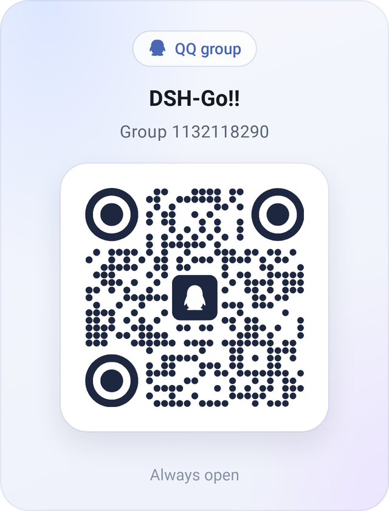</picture></a>&emsp;&emsp;<picture><source media="(prefers-color-scheme: dark)" srcset="docs/assets/qr-wechat-en-dark.webp">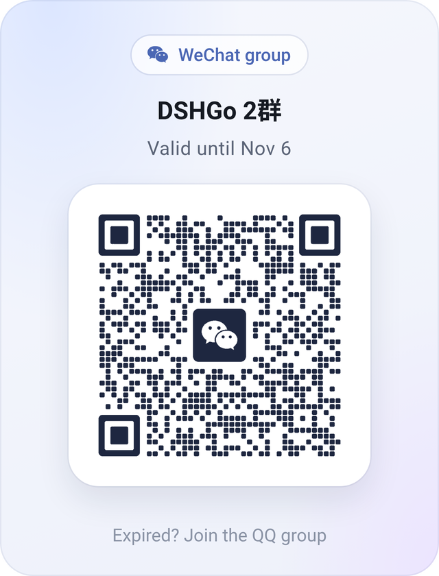</picture>
</p>

<p align="center">
  <sub>QQ group <code>1132118290</code>. On a computer, <a href="https://qm.qq.com/q/OEy2RqZnqY">join with one click</a>. The WeChat code changes every week; if it has expired, join the QQ group.</sub>
</p>

## Friends' Links

- **[DSH-TUI](https://dshtui.com/)**: the interactive terminal UI for DeepSeek Harness by the same author — the desktop counterpart to DSH Go, with a pixel whale, live status and time travel ([GitHub](https://github.com/ccch1mneyyy/dsh-TUI)).

## License scope and redistribution

The code is open source under [AGPL-3.0](LICENSE), and forking it to study, self-host or build on is welcome. Please respect the original author and project origin:

- **Please contact the author before making modifications.** If you plan to modify this project, develop it further or publish a derivative product, please contact the original author, ccch1mneyyy, through [Issues](https://github.com/ccch1mneyyy/dsh-go/issues) or the [community](#community) in advance and describe your intended use and plans.
- **Please credit the upstream repository and author in forks.** When publishing a modified version, please clearly credit <https://github.com/ccch1mneyyy/dsh-go> and the original author, [ccch1mneyyy](https://github.com/ccch1mneyyy), in the repository README, in-app About screen and release page. Retain copyright, license and modification notices as required by the applicable license.
- **No unauthorized commercial reskins.** Do not use this project's brand graphics or protected assets, including Deepy and Whale girl, in reskinned products for sale, paid distribution or other commercial products without permission. Do not violate the applicable license by removing required copyright and license notices or distributing derivative code without the required source, or impersonate the original author or an official release.
- **The name and assets are separate.** The DSH Go name and logo, and the Deepy and Whale girl mascots, are not covered by AGPL-3.0. Ship a modified build under your own name and assets; see [ASSETS.md](ASSETS.md).

**License clarification:** AGPL-3.0 permits modification, redistribution and commercial use subject to its terms. Advance contact and the requested credit locations above are collaboration requests from the author, not additional restrictions on the code license. Brand and asset use remains subject to their own terms; this notice does not change the licenses of `sdk/`, `examples/` or third-party content.

## License and acknowledgments

This project is licensed under [AGPL-3.0](LICENSE). `sdk/` and `examples/` remain **MIT**. Third-party code and assets retain the terms stated in their own notices.

- [DeepSeek Harness](https://github.com/deepseek-ai/deepseek-harness): the agent DSH Go runs and connects to.
- [DSH-TUI](https://github.com/ccch1mneyyy/dsh-TUI): home of the mascots, Deepy and Whale girl.

Code derived from Phase is used under the MIT License with the author's permission. DeepSeek Harness, PiPilot, DS Bot, DSH Remote and other third-party components and assets retain their own licenses and attribution. See [THIRD_PARTY_NOTICES.md](THIRD_PARTY_NOTICES.md) for sources and terms.

The DSH Go name, logo and mascots (Deepy and Whale girl) are not covered by the AGPL; see [ASSETS.md](ASSETS.md) for their terms.

<sub>Remote connections follow the [ds-harness-remote](https://github.com/liguobao/ds-harness-remote) (MIT) protocol; see [THIRD_PARTY_NOTICES.md](THIRD_PARTY_NOTICES.md) for sources and terms.</sub>

<br>

<p align="center"><sub>DSH Go is an unofficial client made by the community. It is not affiliated with or endorsed by DeepSeek. DeepSeek names and marks belong to their owners.</sub></p>
