<p align="center">
  <b>简体中文</b> · <a href="README.en.md">English</a>
</p>

<p align="center">
  <picture>
    <source media="(prefers-color-scheme: dark)" srcset="docs/assets/hero-zh-dark.webp">
    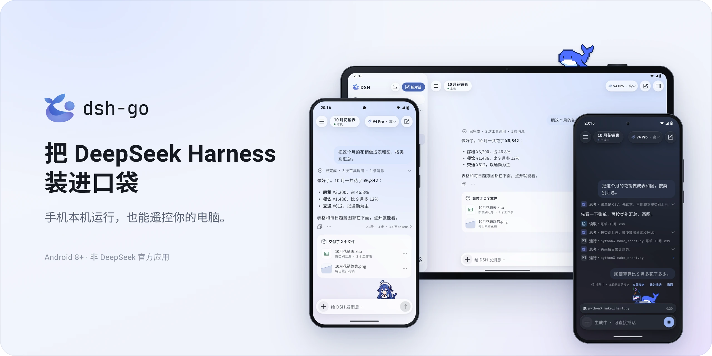
  </picture>
</p>

<p align="center">
  DeepSeek Harness 的 iOS 应用。本目录已裁剪为 iOS 工程，使用 Mac 和 Xcode 自行编译、签名；本机引擎在 App 内按需下载安装（<a href="app/ios/README.md">iOS 构建与引擎配置</a>）。
</p>

<p align="center">
  <a href="app/ios/README.md"></a>
  <a href="LICENSE"></a>
  <a href="https://forum.dshtui.com"></a>
  <a href="https://qm.qq.com/q/OEy2RqZnqY"></a>
</p>

<p align="center">
  <a href="https://trendshift.io/repositories/319451"></a><br>
  <sub>Trendshift 全语言日榜 #1 · 2026-10-30</sub>
</p>

<br>

<h3 align="center">Deepy 和鲸娘，陪你干活</h3>

<p align="center">干活时敲代码，做完来个空翻，等你确认会举手。iOS 的 App 外显示使用系统画中画，桌面小组件展示伙伴状态。</p>

<p align="center">
  <picture><source media="(prefers-color-scheme: dark)" srcset="docs/assets/pet-deepy-typing-zh-dark.gif">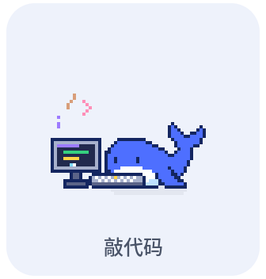</picture> <picture><source media="(prefers-color-scheme: dark)" srcset="docs/assets/pet-deepy-happy-zh-dark.gif">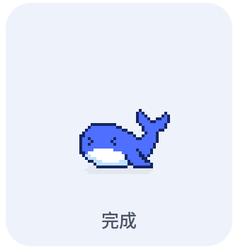</picture> <picture><source media="(prefers-color-scheme: dark)" srcset="docs/assets/pet-deepy-notification-zh-dark.gif">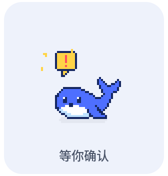</picture> <picture><source media="(prefers-color-scheme: dark)" srcset="docs/assets/pet-deepy-sleeping-zh-dark.gif"></picture>
</p>

<p align="center">
  <picture><source media="(prefers-color-scheme: dark)" srcset="docs/assets/pet-girl-typing-zh-dark.gif"></picture> <picture><source media="(prefers-color-scheme: dark)" srcset="docs/assets/pet-girl-happy-zh-dark.gif"></picture> <picture><source media="(prefers-color-scheme: dark)" srcset="docs/assets/pet-girl-notification-zh-dark.gif"></picture> <picture><source media="(prefers-color-scheme: dark)" srcset="docs/assets/pet-girl-sleeping-zh-dark.gif"></picture>
</p>

<br>

<a id="download"></a>
<h3 align="center">在 Xcode 编译 iOS 应用</h3>

<p align="center">打开 <code>app/ios/Runner.xcworkspace</code>，选择 Runner 和模拟器或你的 iPhone。真机安装需要配置自己的 Apple 签名。</p>

<p align="center">
  <a href="app/ios/README.md"><b>iOS 构建、运行时下载源与真机签名说明</b></a>
</p>

<p align="center">
  <b>这个源码目录不再提供 Android 或鸿蒙构建。上游发布页与下方历史展示图不代表本目录已有公开 iOS 安装包或完成真机验收。</b>
</p>

<p align="center">
  <a href="https://github.com/ccch1mneyyy/dsh-go/stargazers"></a>
</p>

<p align="center">
  <sub>第一次用可以先看<a href="docs/guide/README.md">使用指南</a>，遇到问题欢迎来<a href="#community">论坛和 QQ 群</a>。</sub><br>
  <sub>更换签名或 Bundle ID 前请备份数据；卸载应用会清空其本地运行环境与设置。</sub>
</p>

<br>

<h3 align="center">本机运行，也能遥控电脑</h3>

<p align="center">本机引擎使用 App 进程内的 NodeMobile，可选安装沙箱内的 Alpine Linux。也能连接电脑或服务器上的 DSH。</p>

<p align="center">
  <picture>
    <source media="(prefers-color-scheme: dark)" srcset="docs/assets/f-remote-zh-dark.webp">
    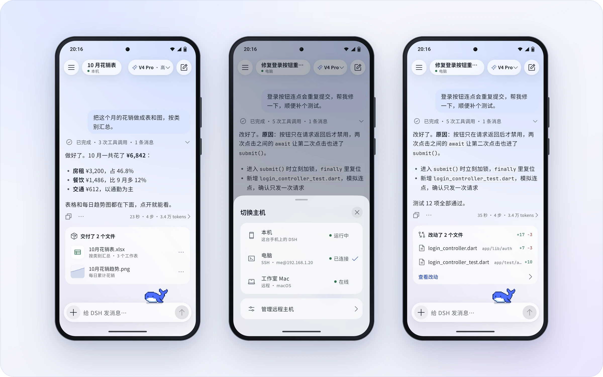
  </picture>
</p>

<br>

<h3 align="center">插话、打断，过程自动收好</h3>

<p align="center">回复中途也能插话，排队的消息随时「立即发送」。做完的过程折叠成一行。</p>

<p align="center">
  <picture>
    <source media="(prefers-color-scheme: dark)" srcset="docs/assets/f-steer-zh-dark.webp">
    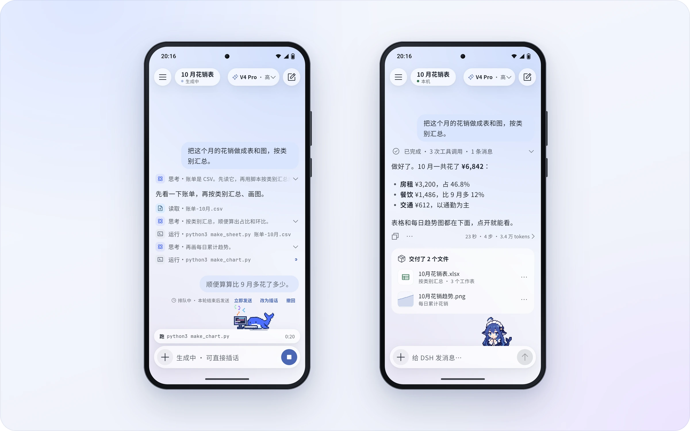
  </picture>
</p>

<br>

<h3 align="center">原生界面，也有网页版</h3>

<p align="center">和官方网页版一键切换，停在同一段对话，下次打开还是你上次用的那个。</p>

<p align="center">
  <picture>
    <source media="(prefers-color-scheme: dark)" srcset="docs/assets/f-web-zh-dark.webp">
    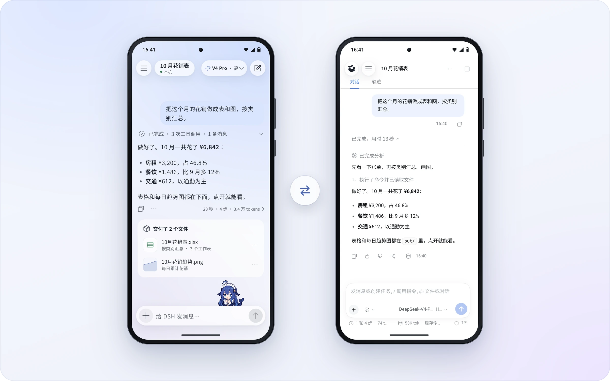
  </picture>
</p>

<br>

<h3 align="center">分享卡、对话回放和链接</h3>

<p align="center">回复一键做成分享卡。整段对话生成链接，对方在浏览器里回放，链接端到端加密。</p>

<p align="center">
  <picture>
    <source media="(prefers-color-scheme: dark)" srcset="docs/assets/f-share-zh-dark.webp">
    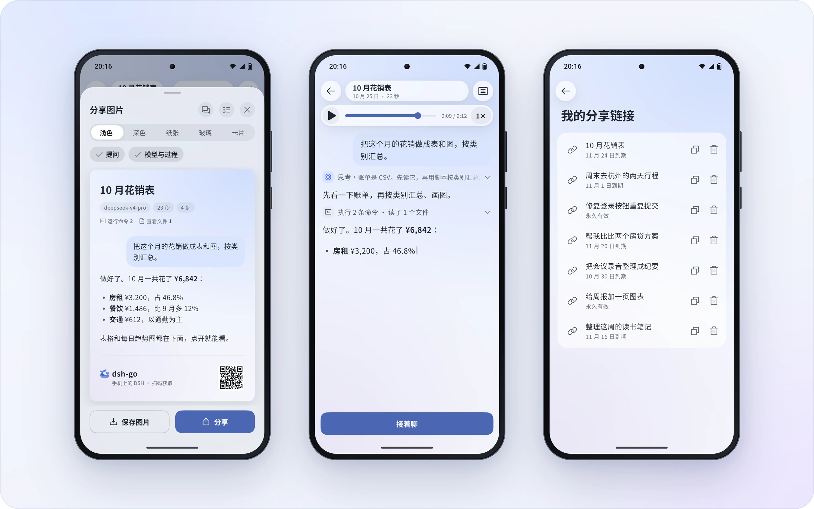
  </picture>
</p>

<br>

<h3 align="center">横屏与平板</h3>

<p align="center">横屏手机和平板重新排版：侧栏常驻，内容居中，弹出键盘也不挤。</p>

<p align="center">
  <picture>
    <source media="(prefers-color-scheme: dark)" srcset="docs/assets/f-adaptive-zh-dark.webp">
    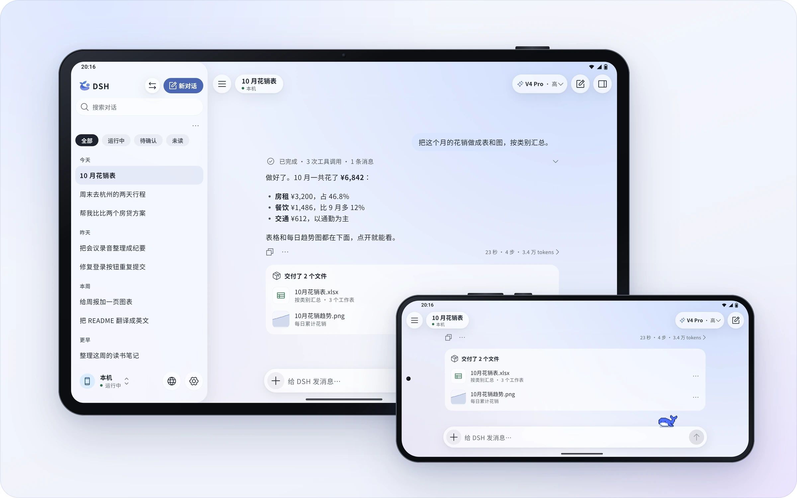
  </picture>
</p>

<br>

<h3 align="center">主题配色与桌面图标</h3>

<p align="center">六套主题色，也能自选颜色。四款桌面图标，三种功能图标风格。</p>

<p align="center">
  <picture>
    <source media="(prefers-color-scheme: dark)" srcset="docs/assets/f-theme-zh-dark.webp">
    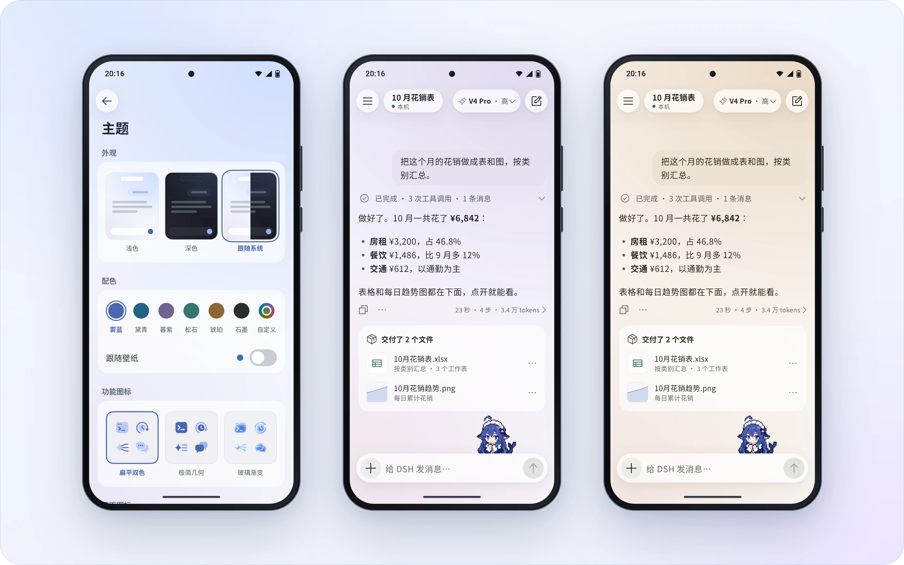
  </picture>
</p>

<br>

<h3 align="center">中文，也说 English</h3>

<p align="center">全部界面支持英文，在设置里切换，默认跟随系统。</p>

<p align="center">
  <picture>
    <source media="(prefers-color-scheme: dark)" srcset="docs/assets/f-lang-dark.webp">
    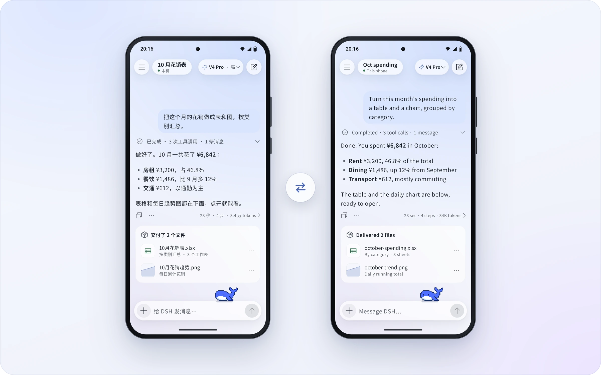
  </picture>
</p>

<br>

<h3 align="center">手机操控</h3>

<p align="center">通过 iOS 开发者连接打开应用、读取屏幕；点按与输入依赖系统服务或单独签名的 XCTest 增强。手机任务需要你授权，敏感操作交还给你。</p>

<p align="center">
  <picture>
    <source media="(prefers-color-scheme: dark)" srcset="docs/assets/f-phone-zh-dark.webp">
    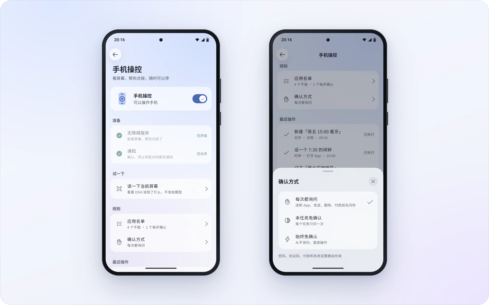
  </picture>
</p>

<br>

## 可以做什么

DSH Go 提供聊天界面、本机运行环境和远程连接，是基于 [DeepSeek Harness](https://github.com/deepseek-ai/deepseek-harness) 的第三方项目。运行在手机上的是 DSH 引擎；模型请求仍由你配置的模型提供方处理。

本目录只保留 iOS 应用与所需共享代码。上面的截图和部分指南保留了上游多平台历史；iOS 当前能力与限制以 [iOS 工程说明](app/ios/README.md)为准。

- **本机运行**：在 App 内下载并安装 DSH 的 JavaScript 运行时，使用随应用签名的 NodeMobile；可选另装 Alpine Linux。
- **远程连接**：通过 SSH 或李国宝老师开发的 [DSHarness Remote](https://github.com/liguobao/ds-harness-remote) 使用电脑、服务器上的 DSH。
- **聊天与工具**：切换模型，发送图片、使用语音输入，处理工具审批和提问；支持聊天界面与网页模式。
- **插件界面**：使用适配 DSH Go 的原生工具卡、表单和面板；仓库提供 SDK、教程和示例。
- **手机操控**：授权后通过 iOS 开发者连接查询、打开应用及 OCR 读屏；点按和输入需设备支持的服务或已签名的 XCTest 增强。
- **分享与外观**：分享、导出和回放对话，调整主题、图标和桌宠。

功能随主机和连接方式不同。DSHarness Remote 当前只支持图片附件，不能在 App 内打开网页版，插件管理限于开关，且不支持 DS Bot 和对话日志导出。详见[本机引擎与远程主机](docs/guide/zh/03-engine-hosts.md)。

## 安装

最低 iOS 15。先按[从源码构建](#从源码构建)准备工程；真机需在 Xcode 配置 Team、Bundle ID 与各扩展共享权限。本次裁剪不代表真机签名、安装或引擎已经在你的设备上验证。

1. 在 Xcode 运行 `Runner`，或将自己的签名构建安装到 iPhone/iPad。
2. 在设置的本机引擎页面点击安装。配置了下载源的构建会下载运行时，核对 SHA-256、文件大小和版本，安装成功后删除下载 ZIP。
3. 安装后启动本机引擎，为模型配置凭据，再开始对话；也可直接连接远程主机。

仅连接远程主机时，不必下载本机运行环境。运行时 ZIP 的发布地址需要由构建者配置并实际上传，示例域名不能直接用于安装。iOS 的后台运行、系统权限和手机操控限制见 [iOS 工程说明](app/ios/README.md)。

## 数据与权限

模型请求会发送给你配置的提供方。开启手机操控后，任务需要的屏幕文字可能发送给模型，支持看图的模型也可能收到截图；请先阅读 App 的权限说明。

“发送匿名使用统计”默认开启，可在首次引导或“设置 → 隐私与分享”关闭。采集范围和关闭后的处理见[常见问题](docs/guide/zh/11-faq.md)。分享内容前，请检查预览；收到链接或文件的人可以保存其中的内容。

## 风险提示与免责声明

DSH Go 是社区开发的非官方项目，与 DeepSeek 无关联，也不代表 DeepSeek。使用前请了解：

- **AI 并非万无一失**：回答、代码和操作可能出错，也可能被网页、消息或文件中的恶意指令误导。请核验重要结果；医疗、法律、投资等高风险决策不应仅依赖 AI 输出。
- **工具会产生真实影响**：本机或远程主机上的命令、文件修改及手机操控可能导致数据丢失、隐私泄露、账号、资金或设备损失。免确认、放宽应用规则或解除限制会减少保护；确认与拦截机制不能保证消除所有风险。建议保留默认保护，只授予必要权限，不在存有支付或银行信息的设备上解除限制。详见[手机操控指南](docs/guide/zh/04-phone-control.md)。
- **第三方服务与费用**：模型、远程主机和插件等按各自条款运行；相关数据处理、服务可用性和费用取决于你选择的服务与配置。本机运行不等于模型离线，也不代表数据不会离开设备。
- **使用前做好防护**：备份重要数据，只连接可信主机、安装可信插件，留意模型用量与费用；不要让 AI 无人值守地处理不可逆或高风险任务。
- **无担保与责任范围**：在适用法律允许的范围内，本软件按“现状”提供，不保证准确性、持续可用性或满足特定用途；相关无担保及责任限制见 [LICENSE](LICENSE) 第 15–17 条。本声明不排除或限制依法不得排除或限制的责任，也不减损你依法享有的权利。

## 常见问题

<details>
<summary><b>和 DeepSeek 官方是什么关系？</b></summary>
<br>

没有关系。DSH Go 是社区开发的非官方客户端，基于开源的 [DeepSeek Harness](https://github.com/deepseek-ai/deepseek-harness) 构建。手机上运行的是 DSH 本身；模型请求发给你配置的模型提供方，需要联网，按你在提供方的账户计费。

</details>

<details>
<summary><b>安全吗？</b></summary>
<br>

本机网页版只接受 App 自己的访问。分享链接端到端加密，密钥只在链接里，服务器看不到内容，但获得完整链接的人可以读取并保存内容。手机操控默认保留敏感操作保护；放宽应用规则或开启「解除限制」会减少这些保护。安全机制不能保证零风险，详见[风险提示与免责声明](#风险提示与免责声明)和[手机操控指南](docs/guide/zh/04-phone-control.md)。

</details>

<details>
<summary><b>切到后台会被杀吗？</b></summary>
<br>

iOS 会限制后台运行。本机引擎可能被暂停；回到前台后应用会检查并恢复连接。iOS 26 的继续处理能力仍由系统决定，不能保证后台一直运行。详见 [iOS 工程说明](app/ios/README.md)。

</details>

<details>
<summary><b>对手机有什么要求？</b></summary>
<br>

iOS 15 及以上的 iPhone/iPad，使用 Mac 和 Xcode 编译、签名。本机引擎需要额外的下载和解压空间，可选 Linux 还会增加占用；只连电脑或服务器可以不装。

</details>

<details>
<summary><b>开源吗？</b></summary>
<br>

开源，代码就在这个仓库，以 [AGPL-3.0](LICENSE) 发布，`sdk/` 和 `examples/` 为 MIT。DSH Go 的名称和标识，以及 Deepy、鲸娘两位吉祥物，不在开源授权范围内，见 [ASSETS.md](ASSETS.md)。再发布和 fork 时的署名要求见[授权范围与再发布](#授权范围与再发布)。

</details>

## 从源码构建

本机工具链为 **macOS、Xcode 27.2、Flutter 3.47.7 / Dart 3.13.5、Python 3.11+**（上游历史 CI 使用 Xcode 26.6）。本机引擎的原生构建还需 LLVM、lld、Meson 和 Ninja，详见 [iOS 工程说明](app/ios/README.md)。保留 `app/pubspec.yaml` 声明的全部字体、图片和 packages。

从本目录根路径执行：

```bash
bash tooling/ios/prepare-engine.sh
python3 tooling/ios/configure-runtime-download.py --url https://your-host/path/
cd app
flutter pub get
open ios/Runner.xcworkspace
```

`prepare-engine.sh` 准备 `app/ios/Engine/runtime.zip`、NodeMobile 与原生构建输入。配置脚本生成 `app/ios/runtime-download.json`，并导出 `dist/ios-runtime/runtime-<SHA256>.zip`。将导出的 ZIP 上传到配置时填写的同一 HTTPS 地址，再构建应用。更新运行时后须重新生成配置并上传对应文件。配置下载源后，Xcode 只嵌入下载元数据、必要原生 frameworks 及少量 iOS 工具资源；运行时在 App 中点击安装时下载。

选中 `Runner` scheme 与模拟器可进行本地编译。真机还需为 `Runner`、`ShareExtension` 和 `CompanionWidget` 配置同一 Team 及兼容的共享权限；没有签名的构建不能安装到 iPhone。

不签名的编译检查在 `app/` 内运行：

```bash
flutter build ios --simulator --debug
flutter build ios --release --no-codesign
```

模拟器下载联调可使用 `--allow-local-debug --url http://127.0.0.1:8787/`，再从 `dist/ios-runtime` 启动本地静态服务器。此 HTTP 回环地址只用于 Debug 模拟器，Release 构建要求 HTTPS。完整命令和原生框架、签名限制见 [iOS 工程说明](app/ios/README.md)。

## 目录

| 路径 | 内容 |
| --- | --- |
| `app/` | Flutter 界面与 iOS Swift/WidgetKit 原生工程 |
| `packages/dsh_client/` | DSH Web API 的 Dart 客户端 |
| `packages/dsh_remote/` | DSH Remote 的 Dart 客户端 |
| `runtime/ios/` | iOS 原生宿主、系统工具、图片与 Linux guest 适配 |
| `runtime/ohos/`、`runtime/shared/` | iOS 引擎仍需使用的共享运行时组成、进程层与构建输入；保留的历史目录名不代表鸿蒙构建入口 |
| `runtime/patches/`、`runtime/bridge/` | 固定版本的引擎补丁与 App 桥接 |
| `sdk/plugin-kit/` | 原生插件作者工具包；在仓库中使用，未发布到 npm |
| `examples/plugins/` | 插件示例 |
| `docs/guide/`、`docs/plugins/`、`docs/pets/`、`docs/live2d/` | 用户指南、插件开发、宠物包与 Live2D 伙伴制作 |
| `docs/assets/` | 本页用到的展示图、桌宠动图和社群二维码 |
| `tooling/ios/` | iOS 引擎准备、下载源配置、构建与诊断脚本 |
| `services/`、`site/`、`infra/` | 配套分享服务、网站和部署材料 |

## 参与贡献

问题反馈和改进建议可提交到 [Issues](https://github.com/ccch1mneyyy/dsh-go/issues)。代码、文档和翻译贡献请先看 [CONTRIBUTING.md](CONTRIBUTING.md)。插件作者可以从[插件教程](docs/plugins/README.md)和 [SDK](sdk/plugin-kit/README.md)开始。

安全问题请按 [SECURITY.md](SECURITY.md) 报告，避免在公开 Issue 中提交漏洞细节或凭据。

<a id="community"></a>

## 社区

- **论坛**：[forum.dshtui.com](https://forum.dshtui.com)
- **QQ 群**：`1132118290`（[点此加群](https://qm.qq.com/q/OEy2RqZnqY)）
- **微信群**：扫下方二维码，过期请加 QQ 群

<p align="center">
  <a href="https://qm.qq.com/q/OEy2RqZnqY"><picture><source media="(prefers-color-scheme: dark)" srcset="docs/assets/qr-qq-zh-dark.webp"></picture></a>&emsp;&emsp;<picture><source media="(prefers-color-scheme: dark)" srcset="docs/assets/qr-wechat-zh-dark.webp"></picture>
</p>

<p align="center">
  <sub>QQ 群号 <code>1132118290</code>，电脑上可<a href="https://qm.qq.com/q/OEy2RqZnqY">直接点此加群</a>。微信群二维码每周更新，过期请加 QQ 群。</sub>
</p>

## 友情链接

- **[DSH-TUI](https://dshtui.com/)**：同一作者的作品，面向 DeepSeek Harness 的交互式终端界面。手机上用 DSH Go，电脑上就用它——像素鲸鱼、实时状态、时间回溯，装上即开工（[GitHub](https://github.com/ccch1mneyyy/dsh-TUI)）。

## 授权范围与再发布

代码以 [AGPL-3.0](LICENSE) 开源，欢迎 fork 学习、自用和二次开发。请尊重原作者和项目来源：

- **改造前请提前联系作者**：如需基于本项目进行改造、二次开发或衍生产品发布，请先通过 [Issues](https://github.com/ccch1mneyyy/dsh-go/issues) 或[社区](#community)联系原作者 ccch1mneyyy，说明用途与计划。
- **fork 请标注主仓库与作者**：基于本仓库改造并发布时，请在仓库说明、应用「关于」页和发布页面清楚标注主仓库 <https://github.com/ccch1mneyyy/dsh-go> 与原作者 [ccch1mneyyy](https://github.com/ccch1mneyyy)，并按适用许可证保留版权、许可及修改声明。
- **禁止未授权商业化套皮**：不得未经授权将本项目的品牌标识、Deepy、鲸娘等受保护素材用于套皮售卖、收费分发或其他商业产品；不得违反适用许可证，删除应保留的版权与许可声明、闭源分发衍生代码，或冒充原作者、官方版本。
- **名称与素材另有限制**：DSH Go 的名称、标识，以及 Deepy、鲸娘形象不在 AGPL 授权范围内，以修改版身份发布时请换成自己的名称和素材，见 [ASSETS.md](ASSETS.md)。

**许可说明**：AGPL-3.0 允许符合其条款的修改、再发布和商业使用；上述提前联系及署名位置是作者的协作请求，不是对代码许可证追加的限制。品牌与素材须遵守各自的授权条件；本说明不改变 `sdk/`、`examples/` 及第三方内容的许可。

## 许可证与致谢

本项目采用 [AGPL-3.0](LICENSE)；`sdk/` 和 `examples/` 保持 **MIT**。第三方代码和素材以各自声明为准。

- [DeepSeek Harness](https://github.com/deepseek-ai/deepseek-harness)：DSH Go 运行和连接的就是它。
- [DSH-TUI](https://github.com/ccch1mneyyy/dsh-TUI)：吉祥物 Deepy 小鲸鱼和鲸娘来自这里。

Phase 相关代码经作者授权按 MIT 许可使用。DeepSeek Harness、PiPilot、DS Bot、DSH Remote 及其他第三方组件、素材保留各自的许可证和署名。具体来源和条款见 [THIRD_PARTY_NOTICES.md](THIRD_PARTY_NOTICES.md)。

DSH Go 的名称、标识、Deepy 小鲸鱼和鲸娘等形象不在 AGPL 授权范围内，使用条款见 [ASSETS.md](ASSETS.md)。

<sub>远程连接协议与 [ds-harness-remote](https://github.com/liguobao/ds-harness-remote)（MIT）兼容；来源与条款见 [THIRD_PARTY_NOTICES.md](THIRD_PARTY_NOTICES.md)。</sub>

<br>

<p align="center"><sub>DSH Go 是社区开发的非官方客户端，与 DeepSeek 没有关联，也不代表 DeepSeek。DeepSeek 名称与标识归其所有者所有。</sub></p>
